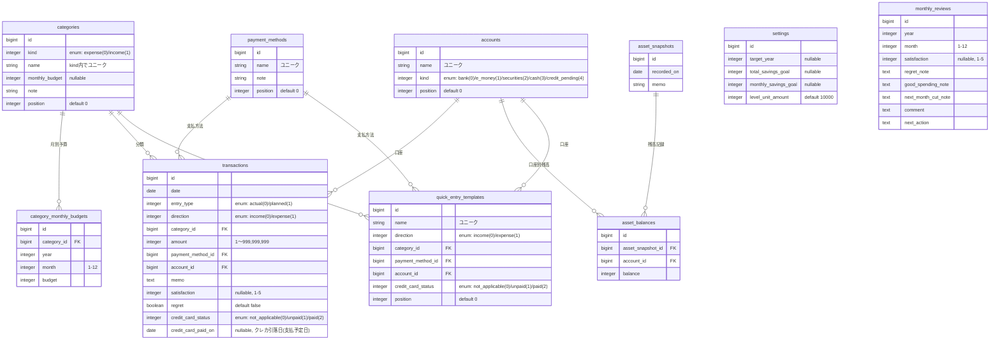

# 家計簿アプリケーション仕様書

## 0. 位置づけ

本書は `docs/要件定義書.md`（Excelからの移行時に作成した初版の要件定義書、2026-08-13時点）に対して、**その後の実装内容に追従して更新していく仕様書**である。

- `docs/要件定義書.md` … 移行時点のスナップショット。背景・移行方針・決定事項ログなど「なぜこう作ったか」の記録として今後もそのまま残す。
- 本書 `docs/アプリケーション仕様書.md` … **現時点の実装が正**。機能追加・仕様変更を行った際は本書を更新し、「今のアプリが何をするか」を常に本書だけで把握できる状態を保つ。両者の内容が食い違う場合は本書を優先する。

最終更新: 2026-10-19（Issue #67の出所追跡・重複防止の実装に追従）

## 1. 概要

Excel家計簿「MONEY QUEST」をRailsアプリとして再構築した、個人利用の家計簿アプリ。v1と同様に**単一利用者・認証なし**を前提とする。

- 日々の収支（取引）を記録する
- 任意タイミングで口座別の資産残高（スナップショット）を記録する
- ダッシュボードで貯金の進捗をゲーム風（貯金レベル）に可視化する
- 月末に振り返り（満足度・後悔支出など）を記録する

## 2. 技術スタック

| 項目 | 内容 |
|---|---|
| 言語・フレームワーク | Ruby 3.3.2 / Rails 7.1.6 |
| フロントエンド | Hotwire（importmap + Turbo + Stimulus）、独自CSS（ライブラリ不使用） |
| グラフ描画 | 外部JSライブラリ不使用。`SvgLineChartHelper` によるインラインSVG自前実装（ダークモード対応、CSSカスタムプロパティで配色を参照） |
| DB（開発・テスト） | MySQL |
| DB（本番） | PostgreSQL（Supabase のConnection Pooler経由） |
| テスト | RSpec（model / service / request / helper）。取込の並行テストは専用MySQL・PostgreSQLで検証 |
| デプロイ | Render（無料プラン、Dockerfileベース） |
| PWA対応 | `public/manifest.json`、各種アイコン、`apple-mobile-web-app-*` メタタグ |

### 運用上の工夫

- Renderの無料プランはアクセスがないとスリープするため、`GET /ping` に外部cronから定期アクセスしてスリープを防止する。`PingController` は `ApplicationController` を継承せず、DBアクセス・ビューレンダリングを一切行わない最小コストの応答（`head :ok`）のみを返す。
- `ApplicationController` で `ArgumentError`（enumに未定義の値を渡された場合など、不正なパラメータ改ざん時に発生）を捕捉し、未処理の500ではなく400を返す。

## 3. 画面構成・ナビゲーション

下部固定ナビゲーション（ボトムナビ）に5項目。

| アイコン | 項目 | 遷移先 |
|---|---|---|
| 🏠 | ホーム | ダッシュボード（ルートパス） |
| 💰 | 取引 | 取引一覧 |
| 📊 | 資産 | 資産スナップショット一覧 |
| 📈 | 集計 | 月別集計（閲覧専用） |
| ⋯ | その他 | 月次振り返り／カテゴリ／口座／支払方法／月別予算／全体設定への入口 |

「その他」配下の画面（月次振り返り、カテゴリ、口座、支払方法、月別予算、全体設定）はボトムナビ上では同じ「その他」タブがアクティブ表示される。

## 4. データモデル

### 4.1 ER図

`settings` は常に1レコードのみ運用（`Setting.current` が `first_or_create!` で取得・生成）。`monthly_reviews` は他テーブルとの外部キーを持たず `year`/`month` の組み合わせで一意。`quick_entry_templates` は取引入力を簡略化するためのテンプレート（5.1参照）で、`entry_type`は持たず常に「実績」固定として使う。

### 4.2 主要な制約・インデックス

- `categories`: `[kind, name]` でユニーク（支出・収入それぞれの中で名前が重複しない）
- `accounts` / `payment_methods`: `name` でユニーク
- `category_monthly_budgets`: `[category_id, year, month]` でユニーク
- `asset_balances`: `[asset_snapshot_id, account_id]` でユニーク（1スナップショット内で口座は重複不可）
- `monthly_reviews`: `[year, month]` でユニーク
- `quick_entry_templates`: `name` でユニーク
- マスタ（`categories` / `accounts` / `payment_methods`）は使用中の取引・残高・クイック入力テンプレートがある場合、`dependent: :restrict_with_error` により削除できない

### 4.3 「年・月・予算対象」はDBに保持しない

要件定義書どおり、取引の年・月・予算対象はDBカラムを持たず、都度導出する。

- 年・月: `date` から算出（`Transaction.in_month(year, month)` スコープで絞り込み）
- 予算対象（`Transaction#budget_target`）: 収入は `:excluded`、支出かつ実績は `:target`、支出かつ予定は `:planned`

### 4.4 集計値もDBに保持しない値オブジェクト

- `MonthlySummary`: 年間/単月の収入予定込・収入実績・支出実績・月予算（カテゴリ別月予算の上書きがあればそちらを優先、なければ `category.monthly_budget`）・予算残・貯金達成率・累計収支を計算する。`build_for_year` は年間分をまとめてメモリ上集計しN+1を回避。
- `CategoryExpenseSummary`: カテゴリ別の当月支出・予算・消費率（`usage_rate`）を計算する。

## 5. 機能仕様

### 5.1 取引管理（`/transactions`）

- 一覧はデフォルトで「今月分表示」。期間切替ボタン（今月分表示／先月分表示／全表示）に加え、`from_date`/`to_date` の手動指定にも対応（手動指定時はどのボタンも非選択状態になる）。パース不能な日付文字列は無視され500にならない。
- 追加の絞り込み: 収支区分・入力区分・カテゴリ・クレカ支払状況
- 登録・編集・削除（CRUD）。必須項目: 日付・収支区分・入力区分・カテゴリ・金額・支払方法・口座。金額は1〜999,999,999の整数。満足度は1〜5または未入力。
- クレジットカード運用: クレジットカード未払い一覧（5.8参照）から未払い（`credit_card_status: unpaid`）の取引を選択し、`PATCH /transactions/mark_credit_card_paid` で一括「支払済」に変更できる。
- クイック入力: 取引一覧上部に「クイック入力テンプレート」（5.3参照）のチップボタンを表示。タップすると`/transactions/new`にテンプレートIDをクエリパラメータ（`quick_entry_template_id`）で渡し、日付=当日・入力区分=実績を固定した上で収支区分・カテゴリ・支払方法・口座・クレカ支払状況をプリフィルした新規登録フォームを開く。ユーザーは金額（と任意でメモ）を入力するだけで登録できる。存在しないテンプレートIDが渡された場合は通常の空フォームにフォールバックする。
- 全画面共通のフローティングボタン（右下「＋」、レイアウト側に配置）から、どの画面からでも1タップで取引登録画面に遷移できる。

### 5.2 資産管理（`/asset_snapshots`）

- 任意の日付で、口座マスタに登録された口座ごとの残高をまとめて記録する（`accepts_nested_attributes_for :asset_balances`）。
- 新規・編集フォームでは、まだ残高未入力の口座についても入力欄を自動生成する（`build_missing_balances`）。既存残高（idあり）を空欄にする編集はバリデーションエラーとして明示させる一方、新規追加行で未入力のまま送信された分は無視する。
- 新規フォームでは、最新（記録日が最も新しい）スナップショットに記録のある口座について、その残高を入力欄の初期値にする（記録のない口座は空欄）。取引からの自動計算は行わず、実際の口座残高を確認して修正する前提のため、最新スナップショットに残高の記録がある場合は、その記録日とともにその旨の注記を出す。
- 合計資産（`total_balance`）・貯金目標との差（`goal_diff`）を自動計算。
- 資産推移グラフは期間フィルタ（直近3ヶ月／直近6ヶ月／直近1年／全期間）付きで表示。
- 残高整合性チェック: 直近2回のスナップショット間で、取引記録から見込まれる口座残高の増減と実際の増減が食い違う口座（種別「銀行」「電子マネー」「証券」「現金」）を警告し、原因の候補（口座の選び間違い・二重登録）をルールベースで推定して表示する。クレカ仮置き口座は、最新スナップショットの残高と現在の未払いクレカ取引合計とを比較する。
- 集計の起点: 原因を特定できない差分は、確認画面（`/asset_snapshots/baseline_preview`）で口座を選び、最新スナップショットの残高を集計の起点にできる（`asset_balances.reconciliation_baseline`）。起点にした口座は前回スナップショットとの比較を行わず、次回以降のスナップショットは起点の残高からの増減でチェックする。過去のスナップショットは書き換えない。起点は資産管理画面の「最新の資産状況」から口座単位で解除でき、解除すると差分が再び表示される。スナップショット一覧では起点の残高に「起点」と表示する。

### 5.3 マスタ管理

| 対象 | パス | 主な項目 |
|---|---|---|
| カテゴリ | `/categories` | 区分（支出/収入）、名称、基本月予算（支出のみ）、備考、表示順 |
| 口座 | `/accounts` | 名称、種別（銀行/電子マネー/証券/現金/未払管理）、表示順 |
| 支払方法 | `/payment_methods` | 名称、備考、表示順 |
| 月別予算 | `/budget_plan`（`edit`/`update` のみ） | 対象年ごとに、支出カテゴリ×1〜12月の予算上書き表 |
| クイック入力テンプレート | `/quick_entry_templates` | 名称、収支区分、カテゴリ、支払方法、口座、クレカ支払状況、表示順。取引一覧画面でのクイック入力（5.1参照）の元になるテンプレート |
| 全体設定 | `/settings`（`edit`/`update` のみ） | 対象年、全体貯金目標、毎月貯金目標、貯金レベル換算額（`level_unit_amount`） |

月別予算の更新（`BudgetPlansController#update`）は、送信値が基本月予算と同値であれば「上書きしない」とみなし、既存の上書きレコードがあれば削除する。同時更新によるユニーク制約違反（`RecordNotUnique`）は1回だけ再取得してリトライする（`MonthlyReviewsController#save_review` も同様の対策）。

### 5.4 ダッシュボード（`/dashboard`、ルート）

- 年切替（前年／翌年リンク）。表示年が現在年と異なる場合、「今月」の概念が存在しないため当月関連の集計・カテゴリ別支出は表示しない。
- 貯金レベル（`現在総資産 ÷ level_unit_amount`、切り捨て）＋レベルバッジ
- 貯金目標に対する進捗率（メーターバー表示）
- 今月の収支（収入予定込・支出実績・収支・予算残額）※表示年が現在年の場合のみ
- 年間収入・年間支出（実績ベース）
- 現在総資産（最新の資産スナップショットの合計）、クレジットカード未払（仮置き）合計（金額は`/credit_card_unpaids`へのリンクになっている）
- カテゴリ別の当月支出一覧（予算比較・消費率バッジ付き。予算・支出がともに0のカテゴリは表示から除外）
- 月別収入・支出推移グラフ（折れ線、インラインSVG）
- カテゴリ別当月支出グラフ（棒グラフ、インラインSVG）

### 5.5 月別集計（`/monthly_summaries`）

- 完全閲覧専用。年切替のみ。
- 標準表示: 月・収入実績・支出実績・実績収支・累計収支
- 詳細表示切替（チェックボックスでの表示/非表示トグル）: 収入予定込・月予算・予算残・毎月貯金目標・貯金達成率
- コメント入力欄は持たない（月次振り返り側に統合済み）

### 5.6 月次振り返り（`/monthly_reviews`）

- 一覧: 年切替、月ごとに収入実績・支出実績・予算残（自動集計）と、登録済みなら満足度・コメントを表示
- 編集（`/monthly_reviews/:year/:month/edit`）: 収入実績・支出実績・予算残を自動表示した上で、満足度(1-5・任意)・後悔支出・良かった支出・来月削るもの・コメント・次の一手を入力する

### 5.7 ゲーミフィケーション

- 貯金レベル = 現在総資産 ÷ `level_unit_amount`（初期値1万円、設定画面で変更可）。ダッシュボードにLVバッジとして表示。
- 貯金目標に対する進捗をメーターバーで視覚化。
- レベルアップ通知・バッジ・連続記録日数などは未実装（要件定義書5.7で「将来拡張の余地」として明記されている範囲）。

### 5.8 クレジットカード未払い一覧（`/credit_card_unpaids`）

- 未払い（`credit_card_status: unpaid`）の取引のみを支払予定日（設定の締め日・支払日から算出。取引ごとに前月/次月へ補正可）ごとにグループ化し、グループ小計・件数、全体合計・件数を表示する完全閲覧＋一括操作用の画面。
- グループは支払予定日の昇順、グループ内は利用日（`date`）の古い順。祝日は考慮しないため、実際の支払日と数日ずれる場合がある旨の注記を出す。
- 全選択/解除チェックボックス（Stimulusコントローラー`select-all`）付きで、選択した取引を`PATCH /transactions/mark_credit_card_paid`に送信し一括「支払済」に変更できる（完了後は本画面に戻る）。
- 一括「支払済」にする際は引落元口座（種別「銀行」の口座のみ、選択必須）を選択する。初期値は設定の「クレジットカードの引落元口座」（銀行口座の場合のみ）。支払済にした取引は、口座（`account_id`）を選択した引落元口座に、引落日（`credit_card_paid_on`）を支払予定日で記録する（支払済のまま利用日・支払予定日を修正した場合も追従する）。資産スナップショットの残高整合性チェックでは、この口座・日付で引落による残高減少を計上する。そのため、クレカの引落は振替として別途登録しない（登録すると二重に減算される）。
- ダッシュボードの「クレカ未払仮置き」、および「その他」メニューの「クレジットカード」グループから遷移できる。

### 5.9 画像取込・出所と重複確認

取込元（サービスキー＋元口座）を初回に設定し、画像アップロード時に選択する。元口座は出所、候補の反映口座は取引先の口座として分けて保持する。サービスキー・元口座は作成後に変更できず、表示名と画像自動反映の許可を編集できる。

同じ取込元・channel・元画像SHA-256の入力は同じ文書へ戻る。ファイル名・手動日付・画像順序はキーに含めない。初回の受付日時・日付指定・受付日を保持し、再送で解析や自動反映を繰り返さない。失敗・未完了の文書は元画像の再アップロードで再試行する。0行成功と失敗は別の結果として表示する。

候補は処理後も残し、文書・行・元候補・編集値・取引ID・処理履歴を辿れる。新規／重複／訂正／保留は重複しない分類で集計する。通常のレビュー一覧は未処理候補を表示し、処理済みだけの文書も結果は表示する。元画像や外部API応答全文は保存しない。

確かな外部IDはサービス＋元口座内で管理し、同じID・同じ版は代表候補へ直接参照する。内容の変化は訂正として保留し、既存取引は自動上書きしない。画像AIの出力は確かな外部IDとして使用しない。外部IDが異なる／ない場合でも、同一反映口座・収支・金額・日付±7日の既存実績・予定・未処理候補を確認対象にする。月を跨いで照合する。同日・同額・同店舗だけを理由に削除・統合しない。

通常の一括承認は新規・問題なしの候補だけ登録する。類似・訂正・保留・矛盾は停止し、詳細画面で比較・手動検索して判断する。「同一」は選んだ取引へ対応付けし、取引の値は変更しない。予定と同一の場合はプレビュー後に同じIDの入力区分だけ実績へ変更する。「別取引」は外部IDの制約がないときに明示操作で別途登録する。未確定IDの訂正は訂正版の初回採用により先行版を終了できる。確認tokenは候補・編集値・比較集合・対象・操作・30分の期限に結びつける。変更があれば再プレビューする。

取引保存と候補の確定・外部IDのbinding・履歴は1 transactionで行う。取込と通常の取引書込みは共通のGuard行を使い直列化する。Guardはschemaロード後の空DBでも実行時に確保する。外部AI通信はロック外。自動反映は一般設定の承認必須=falseと取込元のimage自動許可=trueの両方が必要。初期値は取込元許可=false。確認済みルール1件との一致、原文根拠と日付の確定、通常取引、分類・支払経路・重複の再検証が揃った新規候補だけ登録する。設定変更による過去候補の再処理は行わない。

対応先を通常編集・支払済操作・支払予定日変更・削除した場合は対応の再確認を求める。取引操作自体は従来どおり可能。利用者が現行内容を確認すると対応を維持し、削除確認では歴史ID・削除前snapshotを残して再生成しない終端状態とする。参照候補も同じ結果を見る。履歴のある候補が参照する口座・カテゴリ・支払方法は削除できない。

取込履歴は50文書ずつ表示し、取込元・受付日・解析状態で絞り込める。実際のCSV読取・定期予定生成・画像Job化・現金配分・例外ダッシュボードは未導入。

レビュー画面も50文書ずつページ送りでき、今回の文書集合・batch・画像番号をページ移動と却下後も維持する。通常レビューは「要確認」を初期表示し、「処理済み」へ切り替えられる。アップロード直後の対象文書には自動反映の結果も表示する。今回対象が51文書以上でも全件へ移動できる。

| 代表的な手作業 | 従来 | 今回 |
|---|---|---|
| キャッシュレス10件の初回確認 | 設定に従い10件または0件 | 同じ。問題のある候補は保留 |
| 同じ画像の再送後の個別承認 | 候補を再作成し再確認 | 0件。既存結果へ戻る |
| 取込元の設定 | なし | 初回1回。以降再利用 |
| アップロード時の取込元選択 | なし | 1回 |
| 画像準備・アップロード | 利用者が実施 | 回数は変わらない |
| 重複探し・登録後の手動削除 | 利用者が実施 | 確認対象を表示し二重反映を防ぐ |
| 現金3件・定期1件・クレカ引落1件・残高1回 | 既存操作 | 今回の自動化対象外 |

### 5.10 確認済み分類と例外

分類ルールは取込元・元口座・image・取引先の正規化完全一致・収支で範囲を限定する。NFKC、空白正規化、downcaseだけを使い、記号・支店名を削らない。複数一致は優先順位に関係なく保留する。優先順位は表示順である。新規作成・変更には今後再利用する内容の明示確認が必要で、単発修正から自動学習しない。元実績から作成する場合は確認済み通常取引と現在snapshotを再検証する。ルールは停止・再有効化でき、変更は将来のみで過去実績を書き換えない。

支払方法の画像取込種別は未設定・現金・銀行・電子マネー・クレジットカード・その他。移行時は全件未設定とし名前から推測しない。通常取込では現金/cash、銀行/bank、電子マネー/e_money、カード/支出/credit_pending/未払の整合性を必須にする。カテゴリ区分と収支も一致させる。支払済カードの新規取込、未設定・その他の経路は保留する。通常手入力の仕様は維持する。

日付は原文の完全日付・利用者指定/確認・未確定を区別する。原文は4桁年を含む年月日が厳密に成立し、ISO日付と一致し、年明示=trueかつ不確実性なしの場合だけ確定する。年・読めない日付を当年/当日で補わない。アップロード時の日付一括指定は受け付けず、抽出後に1〜100件を選び、元口座・文書・行・店名・旧日付/出典・新日付をプレビューして全件確定する。古いtoken・処理済み混入は全件無更新。変更後の自動反映は行わない。

チャージ・移動・カード引落・返金/取消・手数料・不明を通常支出へ丸めない。手動の移動/投資には異なる移動先と経路を必須とし、カテゴリを持たせない。手数料は確認した支出のみ。原文の特殊種別を通常取引へ訂正する場合は専用確認と理由が必要で、自動化・ルール作成に転用しない。カード精算や返金相殺を推測実行しない。

反映後の実績訂正は候補詳細から別操作で行い、対象ID・現在値・保存後の差分・関連候補を確認して確定する。30分の署名tokenで対象snapshot・候補version・締め日/支払日設定を固定し、支払済の引落日計算もプレビューに含める。起点候補だけ対応を維持し、他候補はconflictとする。元のappliedイベントは不変。ルールを自動作成しない。

自動成功は再承認を要求せず、確定イベントのmode・金額・収支・ルールsnapshotから件数と方向別金額を表示する。すべての保留理由と一致ルールを表示する。ルール/マスタの後日変更で過去の集計・名称を上書きしない。

## 6. スコープ外（現時点で未実装）

要件定義書10章の内容は本書時点でも変わらず未実装。

- 複数ユーザーでの利用・権限管理・ログイン認証
- 銀行/クレジットカードとの自動連携（API連携、CSV自動取込）
- レシート画像のOCR読み取り
- プッシュ通知・リマインダー
- ヘルプ機能（オンボーディングUI等）

## 7. データ移行

`lib/legacy_import/master_data.rb` / `transactional_data.rb` に、Excel（`docs/家計簿_2026.xlsx`）からのマスタ・取引データ移行スクリプトが存在する（要件定義書8章参照）。`db/seeds.rb` 自体は空。

### 7.1 画像取込候補の移行

現存する旧候補だけをbatchごとのlegacy文書へ移し、候補IDとbatch URLを維持する。移行前に削除された候補・過去画像hash・真の抽出値・元口座は復元できない。既存取引を書き換えず、旧候補は出所不明として保留する。移行は旧画像受付・承認を止めて実施する。履歴を失う自動downは提供しない。本番migration適用・運用切替は今回の開発検証に含めない。

## 8. テスト

現在は `spec/models` / `spec/services` / `spec/requests` / `spec/helpers` にRSpecを配置する。取込ではGeminiだけをモックし、候補保存・照合・反映Serviceとモデルは実クラスを結合して検証する。通常の検証は `bundle exec rspec`。並行テストはtransactional fixturesを当該groupだけ無効にし、独立connectionとbarrierを使用する。使い捨てDB名 `budget_book_app_test_67` / `budget_book_app_test_68` 以外では並行groupを実行しない。`IMPORT_TEST_ADAPTER` / `IMPORT_TEST_DATABASE` と既存のDB接続用環境変数でMySQL・PostgreSQLを切り替える。本番設定は変更しない。

### 作成当時のテスト構成（2026-08-28）

`spec/models/` にモデル単体テストのみ存在（`account_spec.rb` / `asset_balance_spec.rb` / `asset_snapshot_spec.rb` / `category_monthly_budget_spec.rb` / `category_spec.rb` / `monthly_review_spec.rb` / `payment_method_spec.rb` / `setting_spec.rb` / `transaction_spec.rb`）。ほとんどが `pending` のみの雛形で実質未実装。`quick_entry_template_spec.rb` のみバリデーション・削除保護（`restrict_with_error`）の実質的なテストを持つ。コントローラー・システムテストは未整備。

## 9. 変更履歴

| 日付 | 内容 |
|---|---|
| 2026-10-19 | Issue #67：取込元・出所履歴・重複／訂正確認・共通反映処理を追加 |
| 2026-08-28 | クイック入力テンプレート機能（`/quick_entry_templates`、取引一覧でのタップ登録）、クレジットカード未払い一覧画面（`/credit_card_unpaids`）、全画面共通フローティングボタン、PWAショートカット（`public/manifest.json`）を追加 |
| 2026-08-28 | 本書を新規作成。実装（コミット `1b1a125` 時点）を基に要件定義書からの実装状況を整理 |
